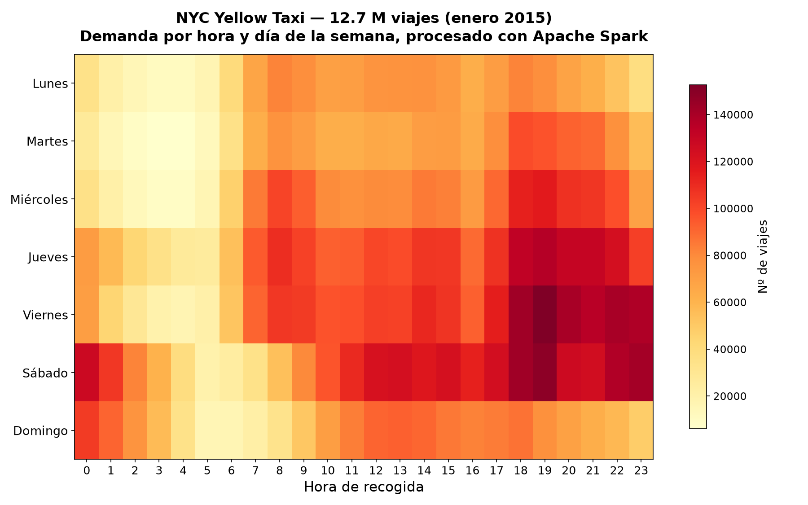

# Viajes de taxi de Nueva York con Apache Spark

11,5 millones de trayectos de taxi amarillo (enero de 2015) procesados en Spark, hasta
cruzarlos uno a uno contra los distritos comunitarios de la ciudad. Módulo de *Spark* del
Máster en Big Data, Data Science e IA de la Universidad Complutense (curso 2025-26).

El notebook va en cinco bloques. Los tres primeros son trabajo de datos: cargar y sanear
los registros inválidos, derivar variables temporales (hora, día de la semana, duración,
velocidad media) y mirar la demanda por horas y por días con *boxplots* facetados y
*heatmaps* hora × día. Ahí ya se ve el pico de hora punta entre semana y el patrón
completamente distinto del fin de semana, que se desplaza a la madrugada.

El cuarto bloque dibuja los *community districts* de NYC con GeoPandas y Folium a partir
del GeoJSON oficial.

El quinto es el que justifica usar Spark. Asignar cada trayecto a su distrito es un
punto-en-polígono repetido once millones y medio de veces; hecho a mano en pandas, no termina.
**Apache Sedona** indexa los polígonos y reparte la operación por el clúster sin salir de
Spark, y el *join* se resuelve en un rato.

## Los datos no están en el repo

Pesan demasiado. Hay que bajarlos de su fuente:

- `yellow_tripdata_2015-01.csv` — [NYC Taxi & Limousine Commission](https://www.nyc.gov/site/tlc/about/tlc-trip-record-data.page).
- `NYC_Community_Districts.geojson` — [portal de datos abiertos de NYC](https://opendata.cityofnewyork.us/).

## Cómo ejecutarlo

Se desarrolló sobre **Databricks Free Edition**, pero sirve cualquier clúster con Spark y
Sedona:

1. Subir los dos ficheros a un *Volume* del catálogo (o a HDFS/S3, según el entorno).
2. Importar `Spark_t2.ipynb` en el workspace.
3. Ajustar `taxi_csv_path` y `geojson_path`.
4. Instalar Apache Sedona en el clúster antes de lanzar el bloque 5. Si no, falla ahí.
